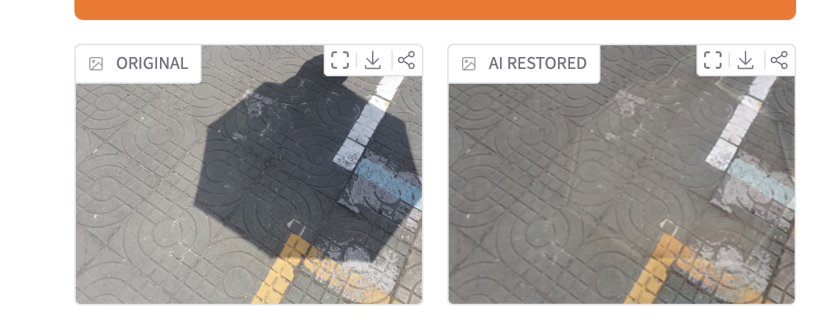
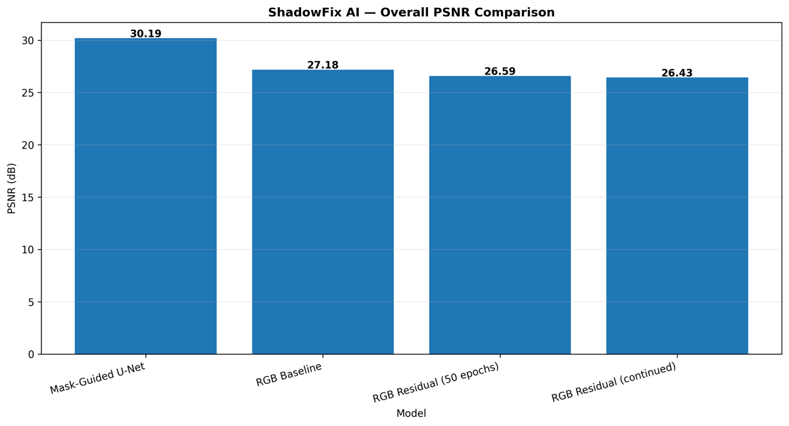
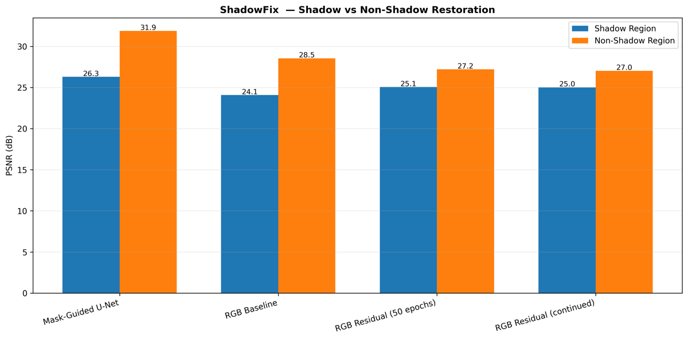
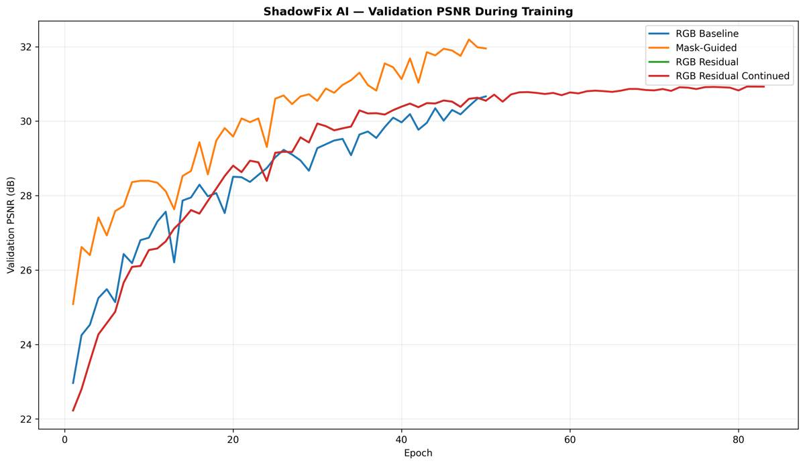
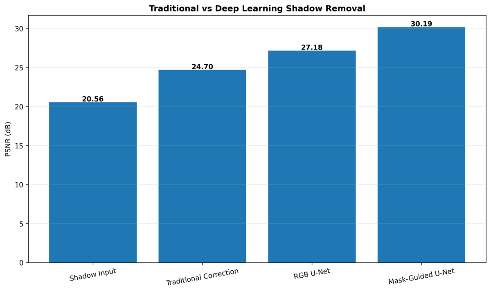
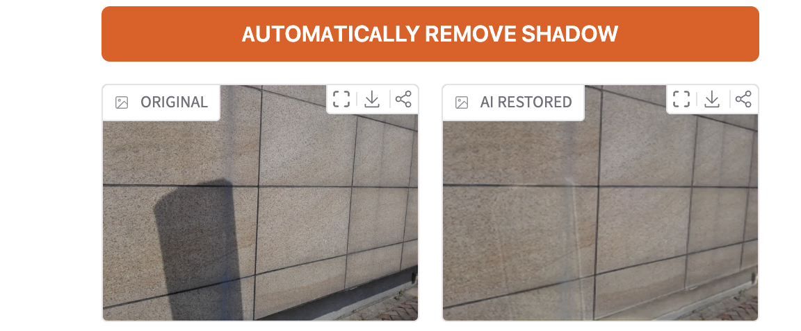
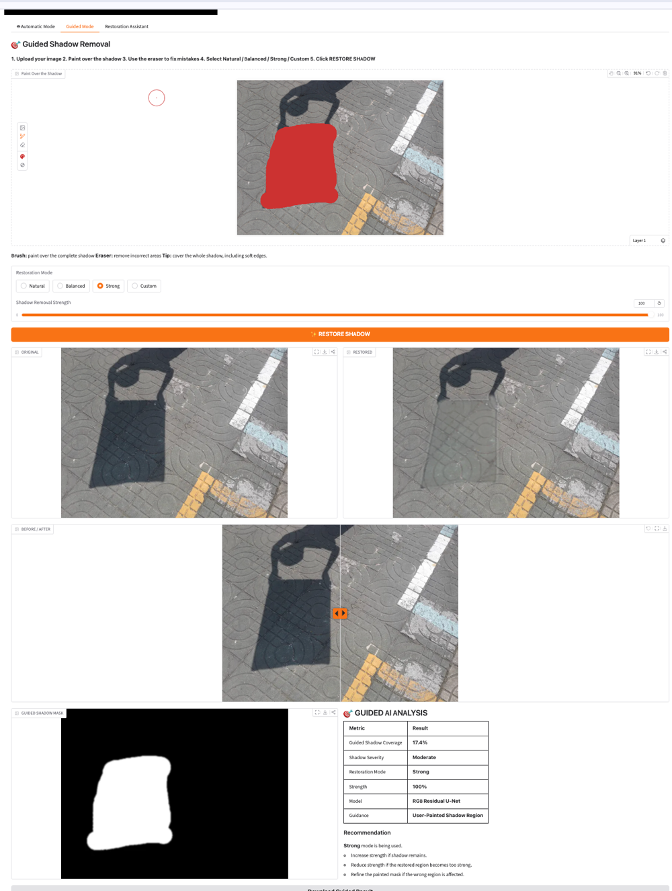

# ShadowFix: Shadow Removal for Real-World Images

   

Shadows hide texture, shift color and create false edges that confuse downstream vision models. **ShadowFix** trains U-Net restoration models on the ISTD benchmark and puts the best one behind a Gradio app with automatic and paint-guided modes.

## Results

540 ISTD test images at 256 × 256 ([raw numbers](assets/results/model_comparison.csv)).

| Model | PSNR (dB) ↑ | SSIM ↑ | Shadow PSNR ↑ | Non-shadow PSNR ↑ |
|---|---:|---:|---:|---:|
| Shadow input (no correction) | 20.56 | – | – | – |
| **Mask-guided U-Net** | **30.19** | **0.951** | **26.30** | **31.89** |
| RGB U-Net baseline | 27.18 | 0.932 | 24.10 | 28.55 |
| RGB residual U-Net (50 epochs) | 26.59 | 0.927 | 25.06 | 27.22 |
| RGB residual U-Net (continued) | 26.43 | 0.927 | 25.03 | 27.04 |

- **+9.6 dB** over the raw shadow input, and **+3.0 dB** overall and **+2.2 dB** inside shadows compared with the RGB baseline.
- **Why we split PSNR by region:** the residual models score *higher inside shadows* but *1.3 dB lower everywhere else*, which means they over-correct pixels that were never shadowed. A single averaged PSNR hides that trade-off.

  
  

  
  

## Demo app

| Automatic mode | Guided mode |
|---|---|
| Upload a photo. The model estimates the shadow region (LAB color-space luminance plus connected-component filtering in OpenCV) and restores it. | Paint over the shadow and pick a restoration strength. The app blends the restored region back into the original and shows the mask, coverage and before/after views. |
|  |  |

## How it works

- **Data:** ISTD triplets (shadow image, shadow mask, shadow-free target): 1,197 train / 133 validation / 540 test.
- **Models:** U-Net encoder–decoder with skip connections (~7.76M parameters, base width 32). The mask-guided variant takes RGB + mask as 4 input channels; the residual variants predict a correction added to the input.
- **Loss:** region-weighted L1, `L = w_s · M ⊙ |P − G| + w_n · (1 − M) ⊙ |P − G|`, weighting shadow pixels more.
- **Training:** PyTorch with mixed precision (AMP) on an NVIDIA T4, batch size 8, 256 × 256 inputs. Checkpoints go to Google Drive so runs survive Colab resets.
- **Evaluation:** PSNR, SSIM, and shadow / non-shadow PSNR, compared against a classical illumination-correction baseline.

## Run it

1. Open [`notebooks/shadow_removal_colab.ipynb`](notebooks/shadow_removal_colab.ipynb) in Google Colab with a GPU runtime.
2. Download the [ISTD dataset](https://github.com/DeepInsight-PCALab/ST-CGAN) and point `DATA_ROOT` in the notebook at it.
3. Run the cells in order: dataset check → training → evaluation → Gradio app.

Install locally with `pip install -r requirements.txt`. Trained checkpoints and the dataset are not stored in this repository.

## Limitations and next steps

- Training at 256 × 256 can soften fine, high-resolution texture. Next: patch-based or full-resolution inference.
- Guided-mode quality depends on the mask. Next: a learned shadow-detection head trained jointly.
- PSNR and SSIM don't fully capture perceptual realism. Next: LPIPS and a small user study.
- Phone photos differ from ISTD. Next: fine-tune on in-the-wild shadow datasets.

## Team

University at Buffalo capstone by **Odra Bira**, Pranay Lachuluri and Rohith Bharadwaj.
